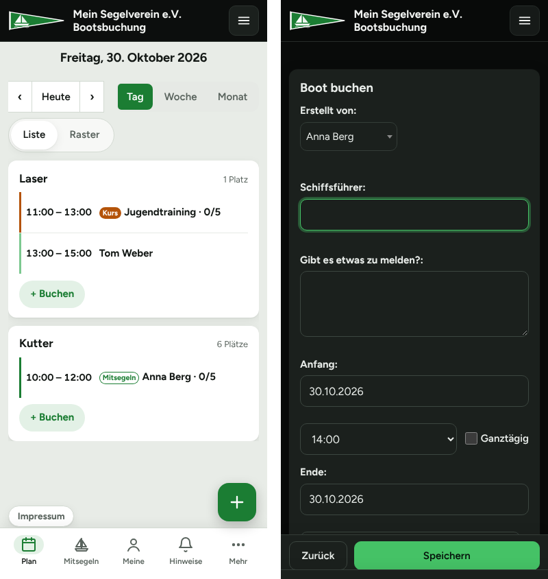

<p align="center"></p>

# Bootsbuchung für Vereine

Eine fertige **Online-Bootsbuchung für Segel- und Wassersportvereine** –
mit Kursen, „Mitsegler willkommen“, Bootsübersicht, Wartungs-Logbuch und einer
modernen Oberfläche für Handy und Computer. Mit **einem Befehl** auf einem
frischen Linux-Server installiert.

Grundlage ist das bewährte Open-Source-Buchungssystem
[MRBS (Meeting Room Booking System)](https://github.com/meeting-room-booking-system/mrbs-code).
Dieses Projekt ergänzt es um alles, was ein Verein für seine Boote braucht.

*English: A ready-to-run boat booking system for (sailing) clubs, based on
MRBS, with courses, crew sign-up, damage reports and a one-command installer.
The user interface is German.*


## Was kann sie?

**Boote buchen**
- Mitglieder buchen Boote im Tages-, Wochen- oder Monatsplan
- Hell/Dunkel automatisch nach Geräteeinstellung oder per Knopf
- Handy-Ansicht wie eine App: Navigation unten, Tagesplan als Karten je Boot,
  „+“-Knopf für neue Buchungen, übersichtliches Buchungsformular

**App und Push-Benachrichtigungen**
- Als App aufs Handy: über den Browser („App installieren“ / „Zum
  Home-Bildschirm“) oder mit der Android-App
  [Bootsbuchung für Vereine](https://github.com/Archonw/bootsbuchung-app)
- Push-Nachrichten statt (oder zusätzlich zu) Mails – jedes Mitglied
  entscheidet selbst auf der Seite „Benachrichtigungen“

**Mitsegler willkommen**
- Wer nicht allein segeln will, hakt „Mitsegler willkommen“ an – andere
  Mitglieder tragen sich in die Buchung ein
- Die Platzzahl ist an die Bootsgröße gebunden (der Schiffsführer zählt mit)
- Bestätigungsmail bei An- und Abmeldung, Info an den Schiffsführer

**Kurse**
- Rolle **Segellehrer** (vom Admin vergeben) – nur Segellehrer können Kurse anbieten
- Kurse dürfen die volle Bootskapazität nutzen (der Segellehrer sitzt nicht immer mit im Boot)
- **Kursreihen**: Schüler melden sich mit einem Klick für alle Termine an
- Wird ein Kurs verschoben oder abgesagt, bekommen alle Angemeldeten eine Mail
- **Erinnerungsmail am Vortag** an alle Angemeldeten, Liste an den Segellehrer
- **Teilnehmerliste zum Ausdrucken** mit Anwesenheits-Spalte

**Seite „Mitsegeln & Kurse“**
- Alle kommenden Kurse und Mitsegelgelegenheiten mit freien Plätzen
- Filter „Meine“: eigene Buchungen und Anmeldungen auf einen Blick

**Bootsübersicht für Mitglieder**
- Menüpunkt „Boote“: alle Boote als Kacheln, pro Boot eine Seite mit
  Titelbild, Bootsdaten (Länge, Breite, Tiefgang, Masthöhe, Gewicht),
  Infotext, Bildern und Dokumenten (Handbuch, Checklisten …)
- Bilder und Dokumente liegen in einem freigegebenen Ordner (z. B. in der
  Vereins-Nextcloud), die Buchung zeigt sie direkt an
- Die Verwaltung der Boote („Verwaltung“) sehen nur Admins

**Wartungs-Logbuch und Schadensmeldungen**
- Pro Boot ein Logbuch: wer hat wann was gemacht, Material, Stunden, Kosten.
  Lesen dürfen alle, eintragen die Rolle **Bootswartung** und Admins
- **Schaden melden** mit Text und Fotos direkt von der Bootsseite – geht als
  offener Eintrag ins Logbuch und per Mail an Bootswart und Boot-Paten
- „Schaden behoben“ mit Notiz, das meldende Mitglied bekommt eine Mail
- **Wartungsbericht** über alle Boote mit Filter, Summen und CSV für Excel

**Meldungen an Bootswart und Boot-Paten**
- Steht bei einer Buchung etwas im Feld „Gibt es etwas zu melden?“
  (Schaden, fehlende Ausrüstung …), geht eine Mail an den **Bootswart** und
  den **Paten des Boots** – Adressen pflegt der Admin direkt in der Webseite
- Optional: pro Boot ein Link zu den **Bootsunterlagen** und eine
  **Fotoablage** für Schadensfotos; Fotos lassen sich direkt aus der Buchung
  hochladen

**Benutzerliste**
- Vorname und Nachname getrennt sortierbar
- Normale Mitglieder sehen nur Namen und Rechte, keine Mailadressen

| | |
|---|---|
|  |  |
|  |  |




## Installation

**Du brauchst:**
- einen Server mit **Ubuntu 22.04/24.04 oder Debian 12** (ein kleiner VPS für
  1–5 €/Monat reicht, ab 1 GB RAM) – oder einen Rechner im Vereinsheim
- für den Zugang aus dem Internet: eine **Domain** (z. B. `buchung.mein-verein.de`),
  deren DNS-Eintrag auf den Server zeigt
- für Mails: ein Mailkonto mit SMTP (z. B. das Vereins-Postfach oder Gmail mit App-Passwort)

**Installieren** – per SSH auf dem Server:

```bash
curl -fsSL https://raw.githubusercontent.com/Archonw/mrbs-bootsbuchung/main/install.sh | sudo bash
```

Das Skript installiert Docker, stellt ein paar Fragen und richtet alles ein
(Dauer etwa 10 Minuten). Gefragt wird nach:

1. **Vereinsname**
2. **Wie die Buchung erreichbar sein soll:**
   - **1 – mit Nginx Proxy Manager:** für einen neuen Server. Der Proxy Manager
     wird mitinstalliert und besorgt das HTTPS-Zertifikat (Let's Encrypt).
   - **2 – vorhandener Proxy:** es läuft schon ein Proxy (Nginx Proxy Manager,
     Caddy, Traefik, Apache …). Die Buchung lauscht nur auf einem Port
     (Standard 8080), der Proxy leitet die Domain dorthin weiter.
   - **3 – ohne Proxy:** direkt auf Port 80, ohne HTTPS – nur fürs Heimnetz oder zum Ausprobieren.
3. **Admin-Konto** (Benutzername, E-Mail, Passwort)
4. **Mailserver** (kann auch später eingerichtet werden)
5. Links zu **Impressum** und **Datenschutz** des Vereins (erscheinen unten rechts)

Am Ende zeigt das Skript die nächsten Schritte an. Bei Variante 1 ist das die
Einrichtung des Proxy Managers (dauert 2 Minuten):

1. `http://SERVER-IP:81` öffnen, Konto für den Proxy Manager anlegen
2. **Hosts → Proxy Hosts → Add Proxy Host**: Domain eintragen,
   *Forward Hostname* `mrbs`, *Port* `80`
3. Reiter **SSL**: „Request a new SSL Certificate“ und „Force SSL“ – speichern
4. Port 81 danach in der Firewall schließen

### Erste Schritte in der Buchung

1. Mit dem Admin-Konto anmelden
2. **Verwaltung** → Bereich „Boote“ → Boote anlegen.
   *Kapazität* = Plätze im Boot **einschließlich** Schiffsführer
3. Im Bereich „Boote“ (bearbeiten) die **E-Mail-Adresse des Bootswarts**
   eintragen, bei jedem Boot optional die des **Boot-Paten**
4. **Benutzerliste** → Mitglieder anlegen. Segellehrern den Haken
   **„Segellehrer“** setzen, wer die Boote pflegt, den Haken
   **„Bootswartung“** (darf ins Wartungs-Logbuch schreiben)
5. Optional: unter **Boot bearbeiten** Bootsdaten, „Infos für Mitglieder“
   und die Links zu Unterlagen und Fotoablage eintragen (siehe
   „Bootsübersicht und Unterlagen“)

## Betrieb

| | |
|---|---|
| Programmordner | `/opt/bootsbuchung` |
| Einstellungen | `/opt/bootsbuchung/config/config.inc.php` – danach `cd /opt/bootsbuchung && docker compose restart mrbs` |
| Aktualisieren (auch PHP-Sicherheitsupdates) | `sudo /opt/bootsbuchung/update.sh` |
| Datensicherung | jede Nacht nach `/opt/bootsbuchung/data/sicherung/` (14 Tage) |
| Protokoll | `/var/log/bootsbuchung.log` |
| Mail testen | `docker exec -i mrbs php < /opt/bootsbuchung/tools/mailtest.php` |
| Erinnerung testen | `sudo /opt/bootsbuchung/maintenance/kurs-erinnerung.sh --probe` |

**Datensicherung:** Die nächtliche Sicherung liegt auf demselben Server.
Kopiere den Ordner `data/sicherung/` zusammen mit `config/` und `.env`
regelmäßig an einen anderen Ort (z. B. Vereins-Nextcloud, rsync, restic) –
sonst ist bei einem Serverausfall alles weg.

**Mail später einrichten:** In `config/config.inc.php` die Zeile
`$mail_settings['disabled'] = true;` durch die SMTP-Zeilen ersetzen (Vorlage:
Abschnitt „Mail“ in `install.sh`), Container neu starten und mit dem
Mailtest prüfen. Für die Erinnerung am Vortag in `/etc/cron.d/bootsbuchung`
die Zeile mit `kurs-erinnerung.sh` ergänzen:
`0 18 * * * root /opt/bootsbuchung/maintenance/kurs-erinnerung.sh >> /var/log/bootsbuchung.log 2>&1`

## App und Push

Die Bootsbuchung ist gleichzeitig eine App. Voraussetzung ist **HTTPS**
(Variante 1 oder 2 der Installation) – ohne HTTPS bleibt sie eine normale
Webseite.

**Auf das Handy bringen** – Mitglieder haben zwei Wege:
- **Android-App „Bootsbuchung für Vereine“**
  ([Quellcode](https://github.com/Archonw/bootsbuchung-app)): installieren,
  beim ersten Start die Adresse der Buchung eingeben (z. B.
  `buchung.mein-verein.de`), fertig. Die App zeigt die Buchung im Vollbild.
  Dafür liefert die Buchung die Datei `/.well-known/assetlinks.json` mit dem
  Fingerabdruck der App aus – sie kommt mit jedem `update.sh` aktuell vom
  Projekt, du musst nichts tun.
- **Ohne App:** die Buchung im Browser öffnen, dann in Chrome
  „App installieren“, auf dem iPhone in Safari „Teilen → Zum Home-Bildschirm“.

**Push-Benachrichtigungen:** Jedes Mitglied schaltet Push unter
**Benachrichtigungen** (Handy: unter „Mehr“) für sein Gerät ein. Danach
kommt jede Mail der Buchung (Anmeldungen, Absagen, Erinnerungen,
Bootswart-Meldungen) zusätzlich sofort als Nachricht aufs Handy. Wer mag,
hakt „Keine Mails mehr“ an – die Mail kommt dann nur noch, wenn die
Push-Nachricht nicht zugestellt werden konnte. Push braucht den
**Mailversand** (siehe „Mail später einrichten“): ohne Mail auch kein Push.

Den Schlüssel für Push erzeugen `install.sh` bzw. `update.sh` selbst und
schreiben ihn als `$bb_push` in die `config.inc.php`. Er bleibt danach immer
gleich. **Nicht weitergeben und nicht austauschen** – mit einem neuen
Schlüssel müssten alle Mitglieder Push neu einschalten. Von Hand erzeugen
(nur falls er fehlt): `docker exec -i mrbs php < /opt/bootsbuchung/tools/push-schluessel.php`
und die Ausgabe in die `config.inc.php` kopieren.

**Angemeldet bleiben:** Damit Mitglieder in der App und beim Antippen einer
Push-Nachricht angemeldet bleiben, steht in der `config.inc.php`
`$cookie_samesite_lax = true;` (trägt `update.sh` bei älteren Installationen nach).

**Name und Farbe der App** (freiwillig, in der `config.inc.php`):

```php
$bb_app = [
  'name'     => 'Bootsbuchung Mein Segelverein',  // Vorgabe: "Bootsbuchung " + Vereinsname
  'kurzname' => 'Boote',                          // Name unter dem App-Symbol
  'farbe'    => '#0c0e0d',                        // Statusleiste, Startbild
];
```

Eigene App-Symbole: die PNG-Dateien in `theme/verein/app/` durch gleich große
ersetzen (`icon-maskable-512.png` mit etwas Rand, weil Android es rund oder
eckig zuschneidet).

**Zum Prüfen** (Chrome am PC): F12 → „Application“ → „Manifest“ zeigt Name
und Symbole, unter „Service workers“ ist `sw.php` aktiviert.

## Bootsübersicht und Unterlagen

Alles wird unter **Verwaltung → Boot bearbeiten** gepflegt (nur Admins):

- **Bootsdaten:** Länge üA, Breite üA, Tiefgang, Masthöhe, Gewicht – freier
  Text mit Einheit, z. B. `6,50 m`. Leere Felder erscheinen nicht.
- **Infos für Mitglieder:** reiner Text (Liegeplatz, Schlüssel …), Leerzeile
  = neuer Absatz, `https://`-Links werden klickbar.
- **Unterlagen (Link):** Freigabelink eines Nextcloud-Ordners (ohne Passwort,
  nur lesen). Die Buchung liest den Ordner über die öffentliche
  WebDAV-Schnittstelle der Freigabe und zeigt Bilder als Galerie, alles
  andere als Dokument zum Herunterladen; Unterordner werden eigene Gruppen.
  Kachelbild ist `titelbild.jpg` (oder `titel.*`, `cover.*`), sonst das erste
  Bild. Der Inhalt wird 15 Minuten zwischengespeichert; Admins haben unten
  auf der Bootsseite „Dateien neu laden“.
- **Fotoablage (Link):** ein *eigener* Nextcloud-Ordner pro Boot, geteilt mit
  der Option **„Dateiablage“** (nur hochladen). Mitglieder laden Schadensfotos
  dann direkt aus der Buchung oder der Schadensmeldung hoch. Für Boote ohne
  eigenen Link gilt `$bb_fotos_url` aus der `config.inc.php`.

In der `config.inc.php` (optional, Vorlage steht schon auskommentiert drin):

```php
// Gemeinsame Fotoablage für Boote ohne eigene:
$bb_fotos_url = 'https://cloud.mein-verein.de/s/…';
// Ordner der Schadensfotos zum Ansehen, als Link in den Mails an
// Bootswart/Boot-Paten ({boot} = Bootsname = Ordnername):
$bb_fotos_ordner_url = 'https://cloud.mein-verein.de/apps/files/?dir=/Schadensfotos/{boot}';
```

Ohne Nextcloud funktionieren Bootsübersicht, Bootsdaten, Infotext,
Wartungs-Logbuch und Schadensmeldungen trotzdem – es fehlen dann nur Bilder,
Dokumente und der Foto-Upload. Links müssen mit `http://` oder `https://`
anfangen. Andere Cloud-Dienste gehen für die reinen Links auch, Galerie und
Upload brauchen eine Nextcloud-Freigabe.

**Wartungsbericht:** im Menü „Bericht“ bzw. im Logbuch über „Bericht“ – alle
Einträge aller Boote mit Filter (Zeitraum, Boot, Art, Status, Suche), Summen
für Stunden und Kosten je Boot und Download als CSV (für Excel).

**Rolle Bootswartung:** Haken beim Benutzer, den nur Admins setzen dürfen
(`bootswartung` steht in `$auth['db']['protected_fields']`; bei älteren
Installationen ergänzt `update.sh` das).

## Wie ist das aufgebaut?

MRBS selbst liegt **nicht** in diesem Repo. `update.sh` holt die gewünschte
MRBS-Version direkt vom MRBS-Projekt, spielt die Anpassungen aus `patches/`
ein und baut daraus ein Docker-Image. Passt ein Patch nicht zu einer neuen
MRBS-Version, bricht das Update ab und die laufende Version bleibt.

```
install.sh            Installation auf einem frischen Server
update.sh             MRBS holen, Patches einspielen, Image bauen, neu starten
docker-compose.yml    MRBS, MariaDB und (optional) Nginx Proxy Manager
patches/              Änderungen am MRBS-Code
  bootswart-meldung     Meldung an Bootswart und Boot-Paten
  kapazitaet            Teilnehmerzahl an die Bootsgröße binden
  kurs                  Kurse, Mitsegler, Kursreihen, Mails, Seite „Mitsegeln & Kurse“, Erinnerung
  app-head              bindet theme/verein/head.inc ein (App-Manifest, Symbole, Service Worker)
  app-assetlinks        /.well-known/assetlinks.json für die Android-App
  push                  Push-Benachrichtigungen, Seite „Benachrichtigungen“
  unterlagen            Links zu Bootsunterlagen und Fotoablage, Foto-Upload in die Nextcloud
  bootsuebersicht       Seite „Boote“, Wartungs-Logbuch, Schaden melden, Wartungsbericht; Verwaltung nur für Admins
  benutzerliste         Vor-/Nachname getrennt, Mitglieder sehen nur Namen und Rechte
theme/verein/         Aussehen (hell/dunkel, Handy-Ansicht wie eine App), Formular-Hilfen, Teilnehmerliste
  app/                  App-Manifest, Symbole, Service Worker, Offline-Seite
sql/                  zusätzliche Datenbankfelder (Segellehrer, Kurs, Push, Boote, Logbuch)
maintenance/          nächtliche Wartung: Sicherung, Sitzungen aufräumen, Erinnerung
tools/mailtest.php    prüft den Mailversand
tools/push-schluessel.php  erzeugt den Schlüssel für Push
```

**Anpassen:** Farben stehen oben in `theme/verein/theme.css` als Variablen
(hell und dunkel). Das Logo ist `theme/verein/logo.svg` – einfach durch das
eigene ersetzen (SVG oder PNG, dann den Dateinamen in der `config.inc.php`
bei `$mrbs_company_logo` anpassen). Begriffe wie „Boot“ oder „Schiffsführer“
stehen als `$vocab_override` in der `config.inc.php`.

Getestet mit MRBS **1.12.2**.

## Wie ist das entstanden?

Die Anforderungen, Entscheidungen und Tests stammen aus dem Alltag eines
Segelvereins. Den Code hat überwiegend die KI **Claude** (Anthropic)
geschrieben – im Dialog und Schritt für Schritt auf einem Testsystem geprüft,
bevor er in den echten Vereinsbetrieb ging.

## Lizenz und Dank

Dieses Projekt steht wie MRBS unter der **GNU General Public License, Version 2**
(siehe [LICENSE](LICENSE)). Du darfst es nutzen, verändern und weitergeben –
Änderungen müssen ebenfalls unter der GPL v2 stehen.

- **MRBS** – Copyright © die MRBS-Entwickler,
  [github.com/meeting-room-booking-system/mrbs-code](https://github.com/meeting-room-booking-system/mrbs-code),
  GPL v2. Die Patches in `patches/` sind Änderungen an MRBS, jede Stelle ist
  mit „Bootsbuchung-Anpassung“ gekennzeichnet.
- **Schrift Figtree** – SIL Open Font License, liegt in `theme/verein/fonts/`
- **Nginx Proxy Manager** und **MariaDB** werden als offizielle Docker-Images
  geladen und stehen unter ihren eigenen Lizenzen.

Entstanden für die Bootsbuchung eines kleinen Segelvereins –
in der Hoffnung, dass sie auch anderen Vereinen die Suche erspart.
Fragen, Fehler und Ideen gerne als [Issue](../../issues).
