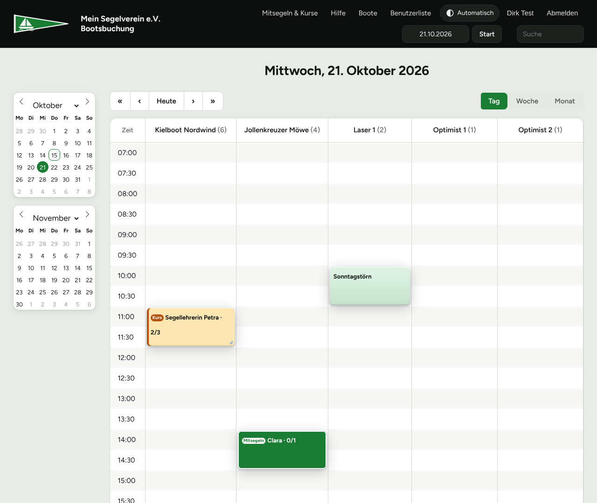
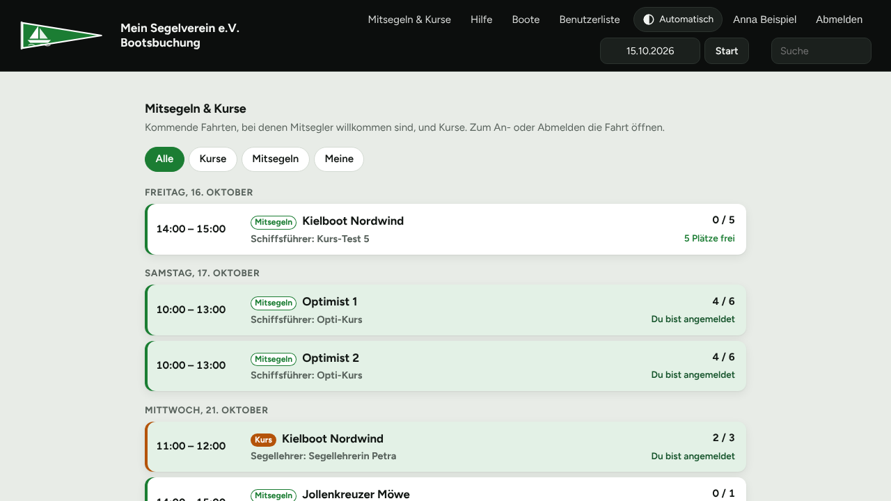
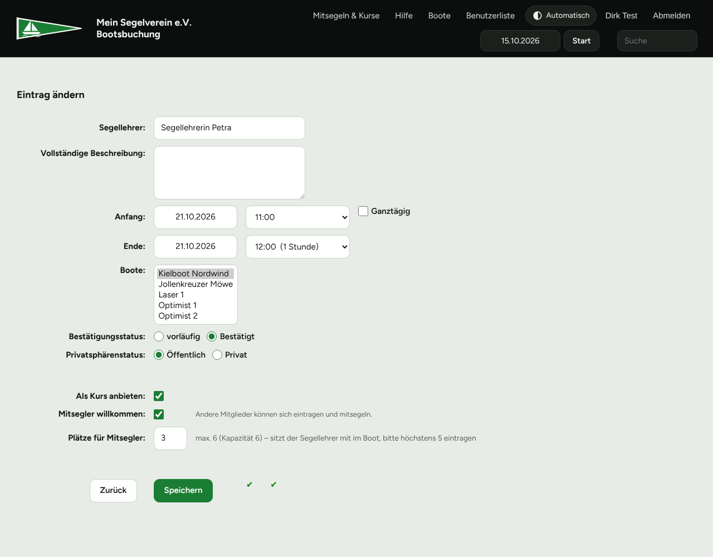
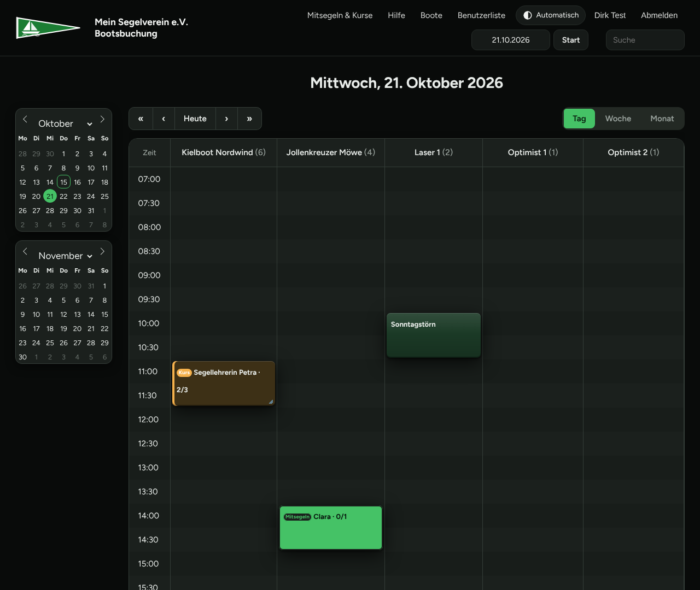
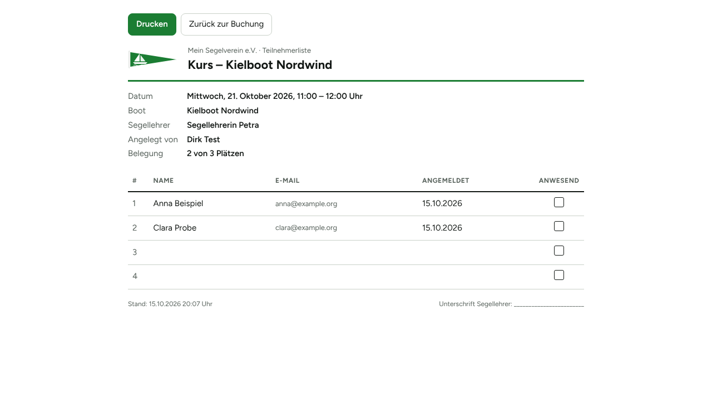
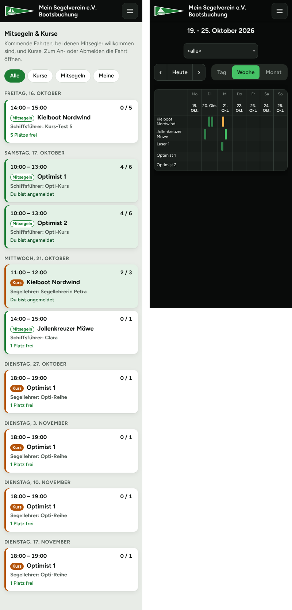

<p align="center"></p>

# Bootsbuchung für Vereine

Eine fertige **Online-Bootsbuchung für Segel- und Wassersportvereine** –
mit Kursen, „Mitsegler willkommen“, Meldungen an den Bootswart und einer
modernen Oberfläche für Handy und Computer. Mit **einem Befehl** auf einem
frischen Linux-Server installiert.

Grundlage ist das bewährte Open-Source-Buchungssystem
[MRBS (Meeting Room Booking System)](https://github.com/meeting-room-booking-system/mrbs-code).
Dieses Projekt ergänzt es um alles, was ein Verein für seine Boote braucht.

*English: A ready-to-run boat booking system for (sailing) clubs, based on
MRBS, with courses, crew sign-up, damage reports and a one-command installer.
The user interface is German.*



## Was kann sie?

**Boote buchen**
- Mitglieder buchen Boote im Tages-, Wochen- oder Monatsplan
- Hell/Dunkel automatisch nach Geräteeinstellung oder per Knopf
- Handy-Ansicht mit Menüknopf und gut erkennbaren Buchungen

**Mitsegler willkommen**
- Wer nicht allein segeln will, hakt „Mitsegler willkommen“ an – andere
  Mitglieder tragen sich in die Buchung ein
- Die Platzzahl ist an die Bootsgröße gebunden (der Schiffsführer zählt mit)
- Bestätigungsmail bei An- und Abmeldung, Info an den Schiffsführer

**Kurse**
- Rolle **Segellehrer** (vom Admin vergeben) – nur Segellehrer können Kurse anbieten
- Kurse dürfen die volle Bootskapazität nutzen (der Segellehrer sitzt nicht immer mit im Boot)
- **Kursreihen**: Schüler melden sich mit einem Klick für alle Termine an
- Wird ein Kurs verschoben oder abgesagt, bekommen alle Angemeldeten eine Mail
- **Erinnerungsmail am Vortag** an alle Angemeldeten, Liste an den Segellehrer
- **Teilnehmerliste zum Ausdrucken** mit Anwesenheits-Spalte

**Seite „Mitsegeln & Kurse“**
- Alle kommenden Kurse und Mitsegelgelegenheiten mit freien Plätzen
- Filter „Meine“: eigene Buchungen und Anmeldungen auf einen Blick

**Meldungen an Bootswart und Boot-Paten**
- Steht bei einer Buchung etwas im Feld „Gibt es etwas zu melden?“
  (Schaden, fehlende Ausrüstung …), geht eine Mail an den **Bootswart** und
  den **Paten des Boots** – Adressen pflegt der Admin direkt in der Webseite

| | |
|---|---|
|  |  |
|  |  |



## Installation

**Du brauchst:**
- einen Server mit **Ubuntu 22.04/24.04 oder Debian 12** (ein kleiner VPS für
  1–5 €/Monat reicht, ab 1 GB RAM) – oder einen Rechner im Vereinsheim
- für den Zugang aus dem Internet: eine **Domain** (z. B. `buchung.mein-verein.de`),
  deren DNS-Eintrag auf den Server zeigt
- für Mails: ein Mailkonto mit SMTP (z. B. das Vereins-Postfach oder Gmail mit App-Passwort)

**Installieren** – per SSH auf dem Server:

```bash
curl -fsSL https://raw.githubusercontent.com/Archonw/mrbs-bootsbuchung/main/install.sh | sudo bash
```

Das Skript installiert Docker, stellt ein paar Fragen und richtet alles ein
(Dauer etwa 10 Minuten). Gefragt wird nach:

1. **Vereinsname**
2. **Wie die Buchung erreichbar sein soll:**
   - **1 – mit Nginx Proxy Manager:** für einen neuen Server. Der Proxy Manager
     wird mitinstalliert und besorgt das HTTPS-Zertifikat (Let's Encrypt).
   - **2 – vorhandener Proxy:** es läuft schon ein Proxy (Nginx Proxy Manager,
     Caddy, Traefik, Apache …). Die Buchung lauscht nur auf einem Port
     (Standard 8080), der Proxy leitet die Domain dorthin weiter.
   - **3 – ohne Proxy:** direkt auf Port 80, ohne HTTPS – nur fürs Heimnetz oder zum Ausprobieren.
3. **Admin-Konto** (Benutzername, E-Mail, Passwort)
4. **Mailserver** (kann auch später eingerichtet werden)
5. Links zu **Impressum** und **Datenschutz** des Vereins (erscheinen unten rechts)

Am Ende zeigt das Skript die nächsten Schritte an. Bei Variante 1 ist das die
Einrichtung des Proxy Managers (dauert 2 Minuten):

1. `http://SERVER-IP:81` öffnen, Konto für den Proxy Manager anlegen
2. **Hosts → Proxy Hosts → Add Proxy Host**: Domain eintragen,
   *Forward Hostname* `mrbs`, *Port* `80`
3. Reiter **SSL**: „Request a new SSL Certificate“ und „Force SSL“ – speichern
4. Port 81 danach in der Firewall schließen

### Erste Schritte in der Buchung

1. Mit dem Admin-Konto anmelden
2. **Boote** → Bereich „Boote“ → Boote anlegen.
   *Kapazität* = Plätze im Boot **einschließlich** Schiffsführer
3. Im Bereich „Boote“ (bearbeiten) die **E-Mail-Adresse des Bootswarts**
   eintragen, bei jedem Boot optional die des **Boot-Paten**
4. **Benutzerliste** → Mitglieder anlegen. Segellehrern den Haken
   **„Segellehrer“** setzen

## Betrieb

| | |
|---|---|
| Programmordner | `/opt/bootsbuchung` |
| Einstellungen | `/opt/bootsbuchung/config/config.inc.php` – danach `cd /opt/bootsbuchung && docker compose restart mrbs` |
| Aktualisieren | `sudo /opt/bootsbuchung/update.sh` |
| Datensicherung | jede Nacht nach `/opt/bootsbuchung/data/sicherung/` (14 Tage) |
| Protokoll | `/var/log/bootsbuchung.log` |
| Mail testen | `docker exec -i mrbs php < /opt/bootsbuchung/tools/mailtest.php` |
| Erinnerung testen | `sudo /opt/bootsbuchung/maintenance/kurs-erinnerung.sh --probe` |

**Datensicherung:** Die nächtliche Sicherung liegt auf demselben Server.
Kopiere den Ordner `data/sicherung/` zusammen mit `config/` und `.env`
regelmäßig an einen anderen Ort (z. B. Vereins-Nextcloud, rsync, restic) –
sonst ist bei einem Serverausfall alles weg.

**Mail später einrichten:** In `config/config.inc.php` die Zeile
`$mail_settings['disabled'] = true;` durch die SMTP-Zeilen ersetzen (Vorlage:
Abschnitt „Mail“ in `install.sh`), Container neu starten und mit dem
Mailtest prüfen. Für die Erinnerung am Vortag in `/etc/cron.d/bootsbuchung`
die Zeile mit `kurs-erinnerung.sh` ergänzen:
`0 18 * * * root /opt/bootsbuchung/maintenance/kurs-erinnerung.sh >> /var/log/bootsbuchung.log 2>&1`

## Wie ist das aufgebaut?

MRBS selbst liegt **nicht** in diesem Repo. `update.sh` holt die gewünschte
MRBS-Version direkt vom MRBS-Projekt, spielt die Anpassungen aus `patches/`
ein und baut daraus ein Docker-Image. Passt ein Patch nicht zu einer neuen
MRBS-Version, bricht das Update ab und die laufende Version bleibt.

```
install.sh            Installation auf einem frischen Server
update.sh             MRBS holen, Patches einspielen, Image bauen, neu starten
docker-compose.yml    MRBS, MariaDB und (optional) Nginx Proxy Manager
patches/              Änderungen am MRBS-Code
  bootswart-meldung     Meldung an Bootswart und Boot-Paten
  kapazitaet            Teilnehmerzahl an die Bootsgröße binden
  kurs                  Kurse, Mitsegler, Kursreihen, Mails, Seite „Mitsegeln & Kurse“, Erinnerung
theme/verein/         Aussehen (hell/dunkel, Handy), Formular-Hilfen, Teilnehmerliste
sql/                  zusätzliche Datenbankfelder (Segellehrer, Kurs)
maintenance/          nächtliche Wartung: Sicherung, Sitzungen aufräumen, Erinnerung
tools/mailtest.php    prüft den Mailversand
```

**Anpassen:** Farben stehen oben in `theme/verein/theme.css` als Variablen
(hell und dunkel). Das Logo ist `theme/verein/logo.svg` – einfach durch das
eigene ersetzen (SVG oder PNG, dann den Dateinamen in der `config.inc.php`
bei `$mrbs_company_logo` anpassen). Begriffe wie „Boot“ oder „Schiffsführer“
stehen als `$vocab_override` in der `config.inc.php`.

Getestet mit MRBS **1.12.2**.

## Wie ist das entstanden?

Die Anforderungen, Entscheidungen und Tests stammen aus dem Alltag eines
Segelvereins. Den Code hat überwiegend die KI **Claude** (Anthropic)
geschrieben – im Dialog und Schritt für Schritt auf einem Testsystem geprüft,
bevor er in den echten Vereinsbetrieb ging.

## Lizenz und Dank

Dieses Projekt steht wie MRBS unter der **GNU General Public License, Version 2**
(siehe [LICENSE](LICENSE)). Du darfst es nutzen, verändern und weitergeben –
Änderungen müssen ebenfalls unter der GPL v2 stehen.

- **MRBS** – Copyright © die MRBS-Entwickler,
  [github.com/meeting-room-booking-system/mrbs-code](https://github.com/meeting-room-booking-system/mrbs-code),
  GPL v2. Die Patches in `patches/` sind Änderungen an MRBS, jede Stelle ist
  mit „Bootsbuchung-Anpassung“ gekennzeichnet.
- **Schrift Figtree** – SIL Open Font License, liegt in `theme/verein/fonts/`
- **Nginx Proxy Manager** und **MariaDB** werden als offizielle Docker-Images
  geladen und stehen unter ihren eigenen Lizenzen.

Entstanden für die Bootsbuchung eines kleinen Segelvereins –
in der Hoffnung, dass sie auch anderen Vereinen die Suche erspart.
Fragen, Fehler und Ideen gerne als [Issue](../../issues).
